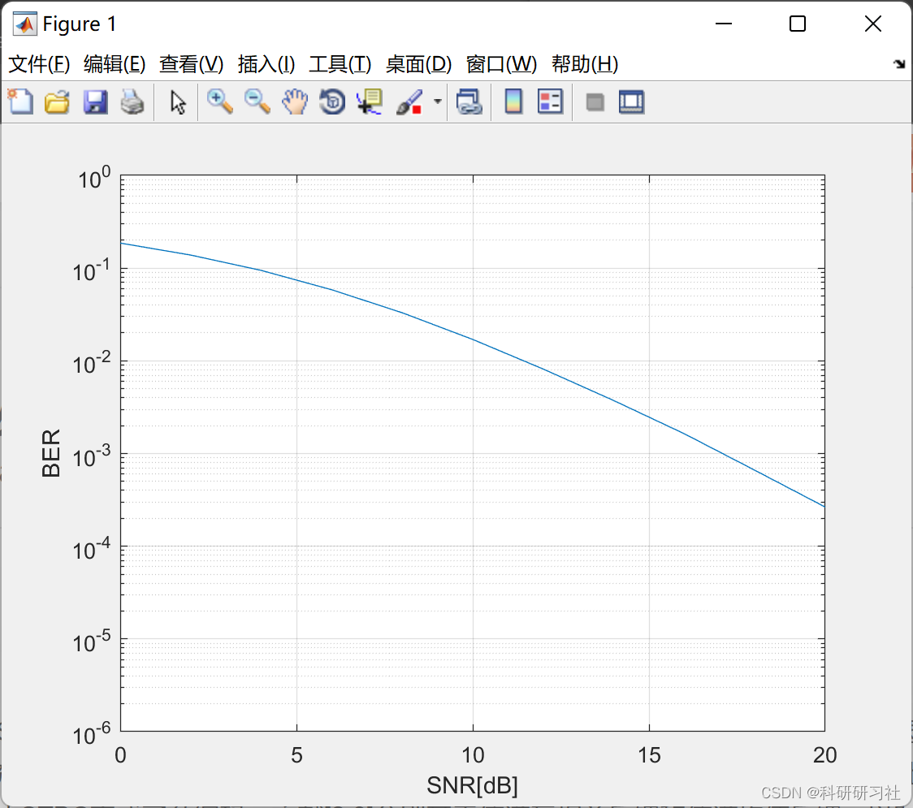

# Diversity of Antennas and Space-Time Coding Technology - Alamouti Space-Time Block Code (MATLAB Code Implementation)

2. Operational Results
2.1 The implementation of the Alamouti Space-Time Block Coding (STBC) with Beamforming (BF) in Matlab code is presented here, highlighting only a portion of the complete code.
2.2 The results are based on the design criterion of minimizing the maximum conditional pair error probability, as described in literature [1].
2.3 In literature [2,3], the signal is subjected to characteristic beamforming and power allocation through time division using feedback from channel cross-correlation or mean feedback, respectively. The objective of combining STBC with BF is to enhance spectral efficiency without altering the original decoding SNR.
2.4 Literature [4,5] proposes a scheme that combines Alamouti STBC6 with BF (hereinafter referred to as the 2Tx scheme). First, the transmitted symbols are encoded using Alamouti STBC. The two branches of encoded signals are then beamformed using the largest and second largest eigenvectors of the channel cross-correlation matrix, constrained by energy. The combined signal is then transmitted via an antenna array.
2.5 For this paper, we present only a portion of the Matlab code, which can be accessed by clicking the link: Antenna Diversity and Space-Time Coding Techniques - Alamouti Space-Time Block Code (Matlab Code Implementation)
function [mod_symbols,sym_table,M] = modulator(bitseq,b)\n\nN_bits = length(bitseq);\nif b==1      % BPSK modulation\n   sym_table=exp(j*[0 -pi]);  \n   sym_table=sym_table([1 0]+1);\n   inp=bitseq;   \n   mod_symbols=sym_table(inp+1);  \n   M=2;\n elseif b==2    % QPSK modulation\n   sym_table = exp(j*pi/4*[-3 3 1 -1]); \n   sym_table=sym_table([0 1 3 2]+1);\n   inp=reshape(bitseq,b,N_bits/b);\n   mod_symbols=sym_table([2 1]*inp+1);  \n   M=4;\n elseif b==3    % generates 8PSK symbols\n   sym_table=exp(j*pi/4*[0:7]);\n   sym_table=sym_table([0 1 3 2 6 7 5 4]+1);\n   inp=reshape(bitseq,b,N_bits/b);\n   mod_symbols=sym_table([4 2 1]*inp+1);\n   M=8;   \n elseif b==4    % 16-QAM modulation\n   m=0;  \n   sq10=sqrt(10);\n   for k=-3:2:3\n      for l=-3:2:3\n         m=m+1; s\n         ym_table(m) = (k+j*l)/sq10; % power normalization\n      end\n   end\n   sym_table = sym_table([0 1 3 2 4 5 7 6 12 13 15 14 8 9 11 10]+1); % Gray code mapping pattern for 8-PSK symbols\n   inp = reshape(bitseq,b,N_bits/b);\n   mod_symbols = sym_table([8 4 2 1]*inp+1);  % maps transmitted bits into 16QAM symbols\n   M=16; %16 constellation points\n else\n   error('Unimplemented modulation');\nend\n\n\n  
🎓 Bloggers' Extracurricular Interests: Eastern and Western Philosophy, Shared with Readers: 👨‍💻 In conducting research, one is involved in a profound intellectual system that requires researchers to be logically precise and diligent. However, it is not just about effort; often, leveraging external resources is more important than mere hard work. Additionally, there should be an innovative point and inspirational aspect of looking up at the stars. When philosophy teachers ask you what science is or electricity is during class, do not think these questions are funny. Philosophy seeks ultimate questions, seeking those questions that only children ask but you cannot answer. In this column, I record some philosophical thoughts and research notes when I have time: Research and Thought. It is recommended that readers read through the entries in order, so as not to suddenly fall into a dark labyrinth without knowing how to return. It may not reveal all the answers to your questions, but if it can raise clouds in your mind, it might also lead to a different scenery of a beautiful sunset. If it brings you a heavy rain in the spiritual world, then take this opportunity to wash away the dust on the "truth" that was originally stored there.
Maybe, after the rain passes, the clear sky of the universe becomes even more serene... 🔎🔎🔎 4 References [1] Li Min, Lin Min, Gong Zhengquan, Peng Runlan, Li Dexiang. Combination scheme of space-time block codes and beamforming performance analysis [J]. Journal of Electronic and Information Engineering, 2008, 30(2): 408-411  
[2] Wang Lijie, Tang Yi, Huang Qinfei, Wei Jiebo. Power allocation in OFDM amplify-and-forward systems with cooperative coding [J]. University of Science and Technology of China Journal, 2012, 34(3): 142-147

## Images

<!-- PAYMENT_BLOCK -->

## Get this dataset

- Payment link (Stripe): [Buy now](https://buy.stripe.com/3cs8yP7sY87d0vu9AB)
- Payment QR code: 

<!-- /PAYMENT_BLOCK -->
